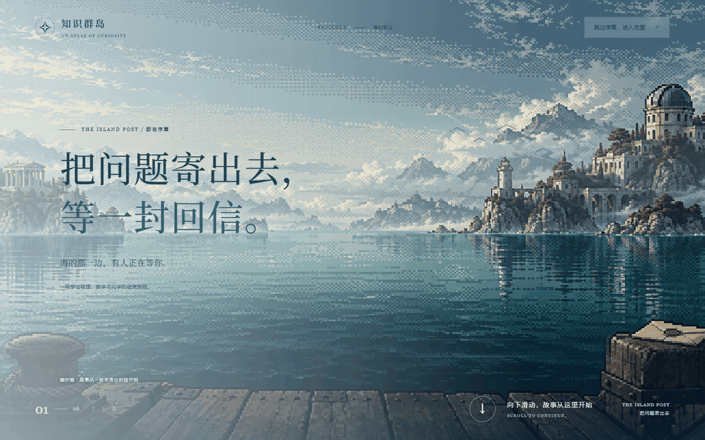
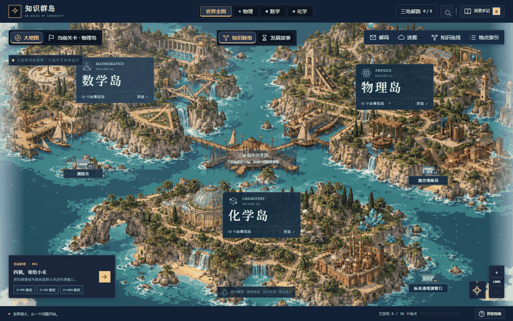
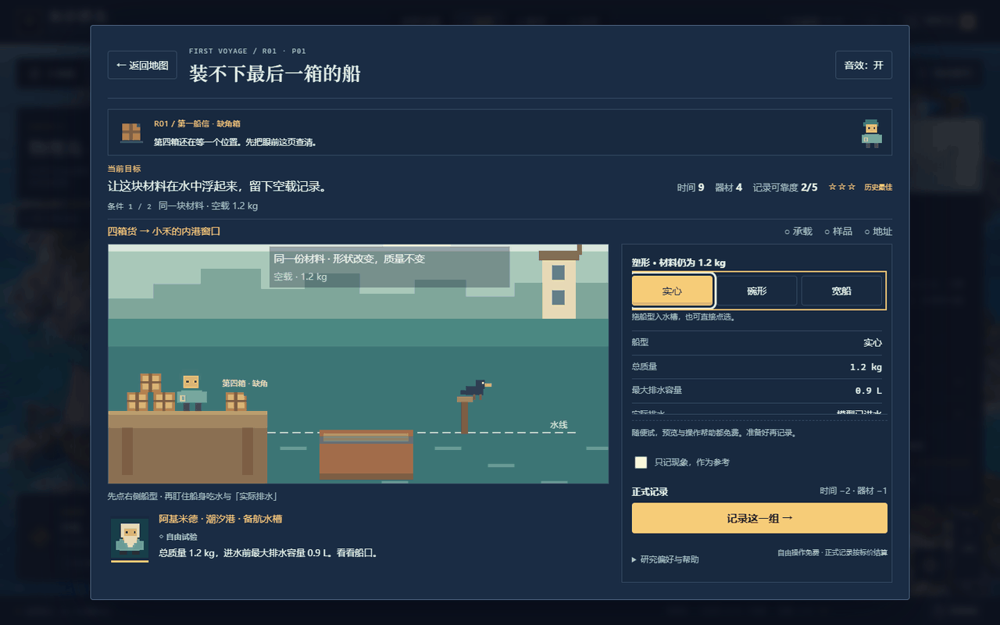
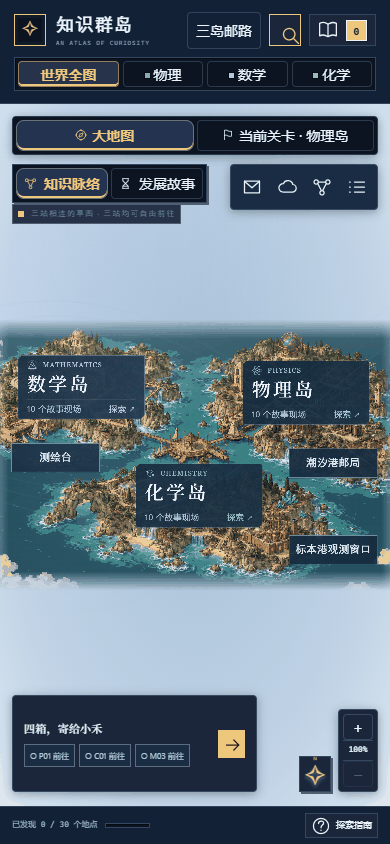
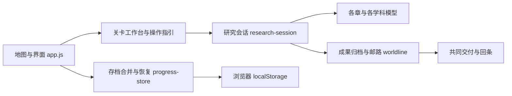

# 知识群岛 · Islands of Knowledge

**在线体验：[打开知识群岛 →](http://121.199.18.146/)**

> 把问题寄出去，等一封回信。

以像素群岛为地图、以信件往返为线索的科学探索游戏。你将成为潮汐港的新信使，在物理、数学、化学三座岛上动手研究，把自己的记录寄给对岸，再根据回条补充和修订。

**3 座学科岛屿 · 30 个可交互现场 · 5 章邮路 · 原生 HTML / CSS / JavaScript**



[快速开始](#快速开始) · [核心玩法](#核心玩法) · [五章邮路](#五章邮路) · [开发与验证](#开发与验证) · [项目结构](#项目结构)

## 为什么做这个项目

教材按章节组织知识，但记住一个公式，不一定能说清它为什么需要、与哪些知识有关、能解释什么现象。

《知识群岛》把这些问题放回具体现场：船装不下最后一箱货，样品的身份签受潮了，“右上那间”不是一个可靠的地址。玩家需要分别查明承载条件、核对样品性质、写出带原点与单位的坐标，再把三份记录交给真正要使用它们的人。

回信可能写着：“我照图做了，但这里不同。”研究因此有了下一步：补证据、说明条件、修改图例，让别人能继续使用和追问。



## 快速开始

需要 Git 和 Node.js 20 或更高版本。预览不需要安装 npm 依赖，也不需要构建。

```bash
git clone https://github.com/caiyi6173-ship-it/Islands-of-Knowledge.git
cd Islands-of-Knowledge
npm start
```

打开 [http://127.0.0.1:4173](http://127.0.0.1:4173)。服务只监听本机地址。

也可以直接打开 `index.html` 或 `学科脉络地图.html`；两个入口内容一致。推荐使用本地 HTTP 服务，以获得稳定的资源加载和存档行为；`file://` 下的存储行为取决于浏览器。

第一次体验可以这样走：

1. 阅读港口序章，或点击跳过、按 `Esc` 直接进入地图；飞行入场也可跳过。
2. 从当前委托进入首航三处现场：物理 P01、化学 C01、数学 M03。
3. 按操作纸条试参数，留下参照条件与新条件的正式记录，再归档成果。
4. 打开“三岛邮路”或回潮汐港邮局，三份成果齐备后交付，接收第一张回条。

地图支持拖动与滚轮缩放；单击地标查看介绍，双击进入。也可使用地点索引，或通过 `Tab`、`Enter` 操作，按 `/` 搜索、`Esc` 关闭窗口。

## 核心玩法

```text
接到问题 → 自由操作与观察 → 正式记录 → 核对条件与依据 → 归档寄出 → 收到回条
```



### 在现场留下可复查的记录

三十个现场共享研究会话，但各有自己的装置、条件和判定。例如，物理首航比较船型与载重，化学首航交叉核对样品性质，数学首航更换原点核对同一窗口的坐标。

| 阶段 | 玩家要做的事 |
|---|---|
| 参照条件 | 操作装置，观察读数，留下第一组依据 |
| 新条件 | 面对新的任务条件，比较、核对或补充记录 |
| 归档成果 | 确认两组条件都有支持目标的有效记录，把结论限制在已检验范围内 |

自由调参、操作提示和开场演出免费；正式记录、咨询与错误操作按关卡规则结算。部分现场还需要提交推理或核对图例，单纯选中答案不能代替实验记录。

新版研究会话使用**时间、器材、信任**三种资源，并保留三种研究偏好：

| 偏好 | 初始资源：时间 / 器材 / 信任 | 特点 |
|---|---|---|
| 助手 | 9 / 4 / 2 | 有更多尝试时间 |
| 工匠 | 7 / 6 / 2 | 器材更多，首条正式记录免器材 |
| 求真者 | 7 / 4 / 3 | 初始信任更高，首次咨询获得更完整的核对提示 |

旧版事件记录仍可查看或继续，其评分与资源规则独立保留。

### 把成果寄给会使用它的人

老乔、阿澜、阿墨、小禾贯穿邮路。邮局的回条绳、图夹、信袋与桌角会留下旅途记录，交付后也能回看成果与伙伴的回应。

研究成果保留记录引用与版本。重做现场不会悄悄改写已经寄出的图册；补充委托可以晚些完成，再寄出补订版本。地图会随有效研究成果逐步恢复色彩，访问地点和知识小测不代替研究完成。

### 自由探索知识之间的联系

除邮路任务外，还可以浏览知识连线、跨学科路线、人物史料卡和本地探索手记，以及投篮、函数和有限模板分子工坊。历史卡与虚构剧情分开呈现。



## 五章邮路

每章包含三项主线与三项补充委托，共 **15 项主线 + 15 项补充**。研究现场可以自由探索，五次主线交付按顺序推进；补充委托不阻挡主线结局。

| 章节 | 标题 | 主线现场 | 共同任务 |
|---|---|---|---|
| R01 | 第一船信 | P01、C01、M03 | 核对船型载重、样品身份与窗口地址，送出四箱货 |
| R02 | 夜班还开着 | P06、C10、M08 | 准备感应操作卡、电路图与回程航向卡 |
| R03 | 对岸看懂了吗 | P07、M06、C04 | 共同修订报码、变换顺序与电子对图例 |
| R04 | 图纸背面的那一行 | P03、M05、C06 | 把轨道、净空与构型页的用途和适用条件写清楚 |
| R05 | 下一次还成立吗 | P10、M10、C08 | 用新记录核对预测、称量边界与模型，完成整圈夜邮 |

完成十五项主线与五次交付后到达结局，仍可继续探索和补寄。详细设计与实现记录见 [世界线总纲](docs/worldline/README.md)。

## 技术与存档

项目没有前端框架、打包步骤或前端运行时依赖。浏览器直接加载脚本；本地服务使用 Node.js 内置的 HTTP、文件与路径模块。Playwright 只用于开发验证。

美术采用混合方式：世界地图、部分岛屿底图与港口使用静态图片或 SVG，研究装置、人物及大量场景由 SVG / Canvas 绘制。旁白音频随项目保存在本地资源目录。



学科模型负责读数与有效性，研究会话负责操作成本与记录，邮路负责成果引用与交付；将它们分开，便于新增现场时沿用存档和叙事流程。

进度保存在当前浏览器的 `localStorage`，主档键为 `knowledge-islands-v2`，支持旧档迁移、跨标签页合并与损坏保护。保存失败时会提示会话模式，此时不能保证刷新后的进度保留。

**没有账号与云同步。** 不同浏览器、设备、域名或端口分别保存进度；清除站点数据会失去对应存档。常用时请固定同一访问地址。

## 开发与验证

单元测试使用 Node.js 内置测试运行器，可以直接运行。浏览器回归需要安装开发依赖，并使用本机已安装的 Chrome：

```bash
npm test                            # 单元测试
npm ci                              # 安装锁定的 Playwright 开发依赖
npm run check                       # 基础脚本语法检查（指定文件集合）
npm run test:browser                 # 高优先级兼容性回归
npm run test:browser:harbor           # 港口序章、飞行入场与跳过
npm run test:browser:map-activation   # 地图单击、双击与快捷入口
npm run test:browser:first-voyage     # 新版首航三关
npm run test:browser:campaign         # 连续主线与结局
npm run test:browser:resilience       # 保存故障、损坏与兼容性
npm run verify                      # 完整验收：语法、双入口、单元测试及全部浏览器组
npm run verify -- --resume           # 输入未变化时复用已通过的浏览器组
```

Windows PowerShell 下，如使用已安装的 Edge，可先设置 `$env:BROWSER_TEST_BROWSER = 'msedge'`。测试服务默认使用 `4188` 端口，可通过 `BROWSER_TEST_PORT` 调整；浏览器测试使用隔离上下文，不读取玩家日常存档。完整脚本列表见 [package.json](package.json)。

**2026-10-29 本轮检查**（Node.js 24.14.1）：

- 447 项单元测试通过，无失败或跳过。
- 149 个 JavaScript 文件通过语法检查，涵盖源码、服务、工具与测试。
- 两个 HTML 入口内容一致，入口的 127 处本地资源引用均可找到对应文件。
- 以下四组浏览器回归共 34 项通过，页面错误 0；本轮未运行完整 `npm run verify`。

| 浏览器回归组 | 通过项数 |
|---|---:|
| 高优先级兼容性 | 6 |
| 港口序章与入场 | 11 |
| 地图操作 | 7 |
| 首航三关 | 10 |

本轮同时修复港口回归脚本的资源地址匹配：图片 URL 带缓存版本参数时，缺图与慢加载模拟现在仍能正确触发。

浏览器回归结果写入本地 `output/browser-regressions/`，完整验收由 `npm run verify` 生成汇总。截图、JSON 和日志默认不提交到仓库；仓库中已有的 [阶段验收记录](output/) 属于历史结果，不能代替当前版本重新执行。

## 项目结构

| 路径 | 内容 |
|---|---|
| `index.html` / `学科脉络地图.html` | 两个内容一致的浏览器入口 |
| `server.cjs` | 仅用于本机预览的静态服务 |
| `src/app.js`、`content.js`、`exploration.js` | 页面协调、知识数据与地图配置 |
| `src/research-session.js`、`progress-store.js` | 新版研究会话、存档合并与恢复 |
| `src/worldline*.js`、`postal-*.js` | 邮路数据、成果交付、邮局与伙伴 |
| `src/first-voyage-*`、`nightwatch-*`、`revision-*`、`atlas-*`、`return-*` | 五章主线模型、绘制与交互 |
| `src/appendix-*` | 十五项补充委托 |
| `src/physics-*`、`math-*`、`chemistry-*` | 学科内容、旧版玩法、史料与实验 |
| `assets/` | 地图与港口素材、序章旁白等资源 |
| `docs/` | PRD、各岛设计、世界线与实现记录；`docs/assets/screens/` 为 README 配图 |
| `tests/` | Node.js 单元测试与浏览器回归脚本 |
| `scripts/` | 验收、静态发布目录生成、美术与旁白辅助工具 |

继续阅读：[产品需求](docs/学科脉络地图PRD.md) · [世界线与阶段索引](docs/worldline/README.md) · [史实边界与资料索引](docs/worldline/07-史实边界与资料索引.md) · [玩家试玩记录](docs/worldline/24-P12玩家试玩记录.md)。

## 当前边界与后续方向

当前版本是可玩的本地产品原型，适合对基础科学感兴趣的学习者，以及课堂中的现象演示。工程验收能检查操作与数据流程，趣味性、学习效果和上手节奏仍需要真实玩家反馈。

- **内容范围有限。** 三十个现场帮助理解概念与联系，不承担完整课程与考纲覆盖。
- **使用教学模型。** 浮力现场不模拟真实船舶适航，化学留样限定候选范围，分子工坊使用有限模板与二维投影。
- **人物对白为创作。** 真实年代、合作者与来源另见史料卡；正式教学发布前仍需学科与历史来源审核。
- **采用本地规则判定。** 没有接入大模型问答，运行不需要后端 API。
- **后续重点。** 继续缩短首次上手路径、统一界面细节，收集试玩反馈并完善内容审核；账号与跨设备进度尚未实现。

## 许可

仓库以 [MIT License](LICENSE) 发布。复用时请保留许可与版权声明。
