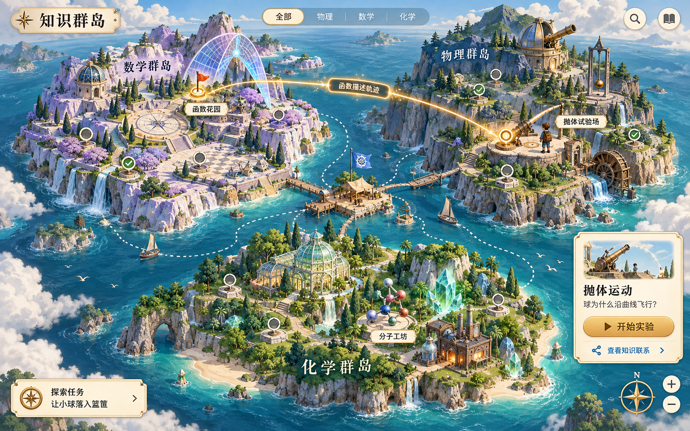

# 学科脉络地图视觉设计方案

日期：2026 年 10 月 14 日  
状态：方向评审稿  
依据：[学科脉络地图产品需求文档](./学科脉络地图PRD.md)

推荐采用“知识群岛”：用具有立体感的手绘游戏地图承载三个学科，概念表现为可访问的地点，实验成为岛上的主要建筑。用户通过选择地点、观察现象和建立联系探索知识世界。

本阶段交付视觉方向与交互方案。配套概念图用于评估氛围、布局和建筑风格；正式界面中的文字、节点、连线、状态与操作区域均需独立制作，以支持缩放、搜索和准确交互。

概念图由内置 imagegen 生成，采用原创场景描述，未使用参考项目的图片作为输入。[完整生成提示词](./assets/knowledge-islands-concept-v1-prompt.txt)随方案保留。图中的部分地标使用场景别名；正式版本按下文规则显示概念名称，并补齐视图切换、小地图和关系图例。

## 参考项目与借鉴内容

| 参考 | 已确认的特点 | 本方案的借鉴 |
| --- | --- | --- |
| [Dorfromantik 官方网站](https://www.toukana.com/dorfromantik) | 以拼放地块形成村落景观，包含不同生态区域与任务 | 安静、值得停留的游戏世界，以及区域辨识度 |
| [Townscaper 官方浏览器演示](https://oskarstalberg.com/Townscaper/) | 可在浏览器体验的城镇搭建作品 | 小型建筑地标、海面留白、玩具模型般的尺度感 |
| [SkillTreeOSS GitHub](https://github.com/Preptics/SkillTreeOSS) | 提供 RPG、World Map 等画布主题、节点侧栏与状态变化 | 学习节点选择后的说明方式，以及可辨认的探索状态 |
| [Azgaar Fantasy Map Generator GitHub](https://github.com/Azgaar/Fantasy-Map-Generator) | 可生成和编辑交互幻想地图 | 把学习空间表现为具有区域、海岸和地名的世界 |
| [Red Blob Games Mapgen2](https://www.redblobgames.com/maps/mapgen2/) | 岛屿地图生成，按游戏需要组织地形 | 用海岸、台地和空间留白服务探索；首版采用手工固定布局 |

借鉴内容是本项目的设计判断。这些项目分别提供视觉、交互或地图组织参考，不构成现成功能或素材复用决定。

## 三种方向比较

| 方向 | 画面描述 | 探索体验 | 主要投入 | 适合程度 |
| --- | --- | --- | --- | --- |
| A 知识群岛 | 日光、海洋、立体手绘岛屿、科学建筑 | 像在冒险游戏中选择地点，进入小实验 | 地形插画、建筑资产、节点与地形协调 | 最推荐，兼顾亲近感与辨识度 |
| B 科学星图 | 深色宇宙、学科星团、轨道与空间站 | 像打开飞船导航，在星团之间探索 | 光效、节点层级、连线可读性 | 适合偏科幻的受众，抽象感更强 |
| C 学者远征图 | 羊皮纸、墨线山脉、手绘仪器、考察笔记 | 像翻阅科学探险家的地图与手册 | 地图纹理、图标、书页式交互 | 适合强调历史故事与科学发展 |

A 的核心吸引力是“一个可以走进去的科学世界”；B 更强调知识网络的宏观结构；C 更强调人类探索知识的过程。

## 推荐方向的视觉定义

### 整体风格

采用固定斜俯视角、具有立体感的二维插画。地形、建筑和树木有明确的高度与柔和阴影，文字与操作控件保持平面、清晰。

地图以青绿海洋为底，岛屿使用温暖岩石、草地和局部学科色。界面使用象牙白纸片、深色文字、少量黄铜边饰，营造科学探险手册的感觉。

角色与建筑比例接近精致桌游模型，适合青少年和成年人。装饰集中在学科地标周围，标签附近留白。

| 元素 | 建议颜色 | 用途 |
| --- | --- | --- |
| 海洋 | #B9D8D2 | 大面积背景，保持安静 |
| 深海线条 | #6F9E9A | 波纹、边界与次要装饰 |
| 纸片界面 | #F7F0DE | 标题、任务、节点预览 |
| 正文 | #283A3B | 正文与主要图标 |
| 物理 | #4D80A8 | 屋顶、旗帜、物理节点轮廓 |
| 数学 | #8B78AB | 几何建筑、数学节点轮廓 |
| 化学 | #588C72 | 温室、化学节点轮廓 |
| 当前选中 | #D5A34C | 选中环、路线强调、小面积高光 |

以上为概念色板，正式视觉稿需单独验证文字与背景的对比度。标题采用有书卷感的中文衬线字形，正文与数字采用清楚的中文黑体；字体选型与授权在制作阶段核实。

### 世界布局

世界由三个主要学科岛和一个很小的起始码头组成。数学在左上，物理在右上，化学在下方，中心留出海域与跨学科连线的空间。

数学与物理的相邻边缘布置函数、向量和抛体地标；物理与化学的相邻边缘布置电路和原电池地标。这种摆放帮助展示首版跨学科路线，但地理距离不直接表示知识的难易、前置关系或历史先后。

起始码头用于说明操作和推荐任务，不作为第四个学科。每个岛内部设置 3 个视觉分区，使 10 个节点形成容易辨认的小组。每组可复用岩石、树木和基础建筑，但关键实验地标要有独立轮廓。

## 三个学科的区域设计

### 物理岛

主题为海岸观测站，包含山坡、观测塔、机械装置和实验场。

三个分区为“运动坡地”“能量高台”“电学海岸”。岛上最醒目的地标是抛体试验场：能看到发射台、篮筐和一条短暂出现的轨迹；选中后可播放示意预览，实际计算在进入实验后进行。

摆锤、望远镜和小型发电装置提供学科识别。小型装饰动画轮流出现，避免所有装置同时运动。

### 数学岛

主题为几何花园与测绘台地，包含坐标石板、几何庭院、对称拱门和测量器具。

三个分区为“数量庭院”“函数花园”“结构台地”。主地标是函数花园：带有坐标网格的广场上立着一座抛物线形拱架，选中后显示顶点与对称轴的简短示意。

几何线条参与地面铺装和建筑结构，形成与其他岛不同的视觉语言；不把整片区域画成公式墙。

### 化学岛

主题为玻璃温室与物质工坊，包含实验玻璃房、矿物、分子模型和电化学小站。

三个分区为“物质园地”“分子温室”“反应工坊”。主地标是分子工坊：玻璃屋中展示球棍模型，门前的原子托盘提示搭建玩法。

装饰使用透明玻璃、矿物切面和模型结构。气泡和蒸汽只用于环境氛围，不作为具体化学反应的解释。

### 首版节点到地标的对应

所有节点先展示正式概念名称，选中后再显示场景别名。例如标签写“函数”，详情副标题写“函数花园”。

| 物理节点与地点 | 数学节点与地点 | 化学节点与地点 |
| --- | --- | --- |
| P01 位置与运动／观测起点 | M01 数与运算／数轴庭院 | C01 物质与性质／物质展亭 |
| P02 速度与加速度／计时跑道 | M02 未知量与方程／天平广场 | C02 原子与元素／元素标本馆 |
| P03 向量与分解／方向台 | M03 坐标／测绘台 | C03 电子与价电子／电子模型亭 |
| P04 力与运动变化／受力试验台 | M04 函数／函数花园 | C04 共价键入门／成键工作台 |
| P05 抛体运动／抛体试验场 | M05 二次函数／抛物线拱门 | C05 分子与组成／分子陈列馆 |
| P06 功与能量／能量高台 | M06 图形变换／变换试验场 | C06 分子空间结构／分子工坊 |
| P07 场的初步概念／场线观测台 | M07 几何关系／几何庭院 | C07 结构与性质／性质对照室 |
| P08 电势差／电势观测台 | M08 向量表示／向量步道 | C08 化学反应与守恒／守恒工作台 |
| P09 电流与电路／电路实验站 | M09 变化率／变化观测塔 | C09 氧化还原／电子转移展亭 |
| P10 能量转换／能量转换站 | M10 数学建模／模型研究所 | C10 原电池／电化学小站 |

## 从总览到细节的三个尺度

| 尺度 | 展示内容 | 用户操作 |
| --- | --- | --- |
| 世界总览 | 三个岛名、三个实验主地标、少量推荐入口 | 选学科、选问题、查看跨学科路线 |
| 学科探索 | 当前学科的 10 个节点、三个分区、节点状态 | 选节点、看关联、打开知识卡 |
| 节点聚焦 | 选中地点、附近相关节点、关系说明、预览面板 | 开始实验、阅读、跳转关联节点 |

缩放时逐步显示标签与细节，同一节点保持固定位置。搜索结果定位到对应尺度，选中标签始终可见。显示密度随尺度变化，首屏不同时展开 30 个长标签。

## 知识关系如何融入游戏地图

### 地形与知识分层

地图中的步道、码头与建筑属于空间装饰；推荐探索路线用浅色点线和“推荐路线”标记表示；知识关系使用可选中的专用线条和文字说明。

默认只显示当前节点相关的知识边。用户打开“全部关系”时，减少地形细节的对比，突出节点和连线。点击连线显示完整解释，鼠标悬停只用于辅助预览。

| 关系 | 视觉表现 | 标签示例 |
| --- | --- | --- |
| 建议先了解 | 带空心箭头的细虚线 | 先了解函数会更容易 |
| 描述或解释 | 带箭头的实线 | 二次函数描述理想轨迹 |
| 应用于 | 带箭头与小应用图标的实线 | 氧化还原应用于原电池 |
| 可对照理解 | 无箭头的细双向连接符号 | 两种向量表示可以对照 |

线型外同时显示关系名称，保证用户不必记住图例。跨海连接可表现为光带，但只在当前路线或节点需要时出现。

### 跨学科桥梁

选择“抛体运动”后，地图强调到“二次函数”的关系，并显示“数学能帮我们描述这条轨迹”。点击“去数学看看”后，镜头移动到数学岛，对应节点打开。

选择“原电池”时，强调到“电势差”“电流与电路”“能量转换”的关系。切换路线不会清除原实验状态。

完整世界地图始终可以自由进入。探索状态用标记呈现，不遮蔽概念名称，也不通过物理断桥阻止用户访问知识。

## 节点状态与游戏反馈

| 状态 | 地图表达 |
| --- | --- |
| 未访问 | 清晰可见的建筑，空心节点标记 |
| 已访问 | 建筑旁增加一面小旗，标注“已访问” |
| 已完成节点验证 | 节点出现勾选印章，标注“已验证” |
| 实验场景任务已完成 | 实验门牌显示独立完成标记，不改变其他节点状态 |
| 联系已验证 | 对应知识边保留一个小连接印章 |
| 当前选中 | 地面金色轮廓环与固定文字标签 |

完成实验返回地图后，只播放一次约 1 秒的反馈：镜头回到实验地标，新增标记出现，再突出本次涉及的知识联系。用户可立即继续操作。

状态变化采用旗帜、印章等附加物，不让未验证的建筑显得破败或不可进入。概念没有被用户访问，不代表知识本身不存在。

## 屏幕上的界面布局

以 1440×900 桌面画布作为首轮设计基准。

- 地图铺满可用视口，顶部保留一条轻量导航，含名称、学科切换、视图切换和搜索。
- 左下显示当前探索任务，可折叠，默认只保留一个任务。
- 右下放置小地图、缩放、适应全部和地图图例。
- 选中节点后，在右侧展开约 320 像素的纸片式预览面板，包含概念名、关键问题、状态、实验或阅读入口和相关知识。
- 打开完整知识卡后使用阅读面板，地图仍保留为背景，关闭后回到原位置。
- 侧栏展开时，相机平移保证选中地标处于可见区域，避免被面板遮住。

面板圆角与黄铜装饰轻量使用。地图文字固定为屏幕可读字号，不跟随缩放无限变小。装饰性地名可作为插画的一部分，功能标签保持独立图层。

## 一次具体的探索体验

1. 页面出现三个岛，起始任务提示“让小球落入篮筐”。用户可直接点击物理岛的试验场。
2. 试验场出现选中轮廓，预览面板展示“抛体运动”和“球为什么沿曲线飞行”。
3. 用户进入实验，调整速度与角度，完成进球与解释验证。
4. 返回地图后，实验门牌增加完成标记，节点根据实际验证结果更新。
5. 系统突出“二次函数描述理想轨迹”这条跨海知识联系。
6. 用户选择数学视角，镜头移动到抛物线拱门，进入函数实验。
7. 用户可从顶部随时回到世界总览，选择化学岛开始另一条路线。

小探险者作为位置指示物，可在切换地点时短暂移动；点击目的地即可打开内容，不要求等待角色走路。

## 发展脉络的视觉表现

顶部提供“知识关系”和“发展故事”切换。发展故事视图仍保留相同岛屿空间，减少知识边，在相关地标附近出现故事卷轴和事件卡。

每科只有首版收录的 3 张故事卡。侧栏按经审核的时期排列，用户选择故事后定位相关地点。数学、物理、化学各自的故事时间跨度不同，不把三个岛硬排成一个统一的进度条。

画面可增加轻微旧纸色调，表达查阅科学史笔记的感觉。概念位置保持稳定，用户不会在切换视图后失去方向。

## 动画与声音

- 环境动画集中于少量重点：海面波纹、缓慢云影、一个摆锤或一座模型装置。
- 镜头定位约 400 至 650 毫秒，允许用户操作立即打断。
- 悬停反馈约 120 至 180 毫秒，抬高地标或出现轮廓，不使整片地图缩放。
- 节点验证后盖章，联系验证后短暂点亮对应边。
- 首版声音默认关闭；若提供，使用轻微翻页、落印和实验提示声，由用户主动开启。
- 减少动态效果模式关闭镜头飞行与循环装饰，保留状态与反馈文字。

## 制作方式与资源范围

首版建议采用二维渲染配合立体插画，使用固定镜头角度。地形可以栅格化，节点、标签、关系、选择状态和交互区域保持独立；不要求可自由旋转的完整三维世界。

首批美术资源包括 3 套岛屿地形、3 个独立实验主建筑、27 个次级地标、树木岩石等复用装饰、节点与状态图标、纸片界面组件及小探险者指示物。次级地标通过基础建筑加学科装置形成变体，以控制工作量。

岛屿位置与知识节点固定编排，不使用运行时随机生成。地形生成项目用于参考地貌组织方法，不需要把完整地图编辑器接入产品。

下一阶段先制作一张世界总览设计稿、一张物理岛放大稿和一张“抛体运动选中”状态稿，再制作地图可交互原型。这样可以先检验画面吸引力、文字可读性和知识关系的清楚程度。

## 本轮评审重点

本轮需要判断三个问题：是否喜欢温暖手绘的群岛风格；是否接受概念与建筑地标的对应方式；是否认可“自由探索加实验入口”的地图玩法。

若更偏好科技感，可沿 B 方向制作科学星图；若更看重科学史，可沿 C 方向制作学者远征图。三种方向保持相同的知识结构与学习状态定义，主要区别在空间隐喻、美术资产和反馈表现。
